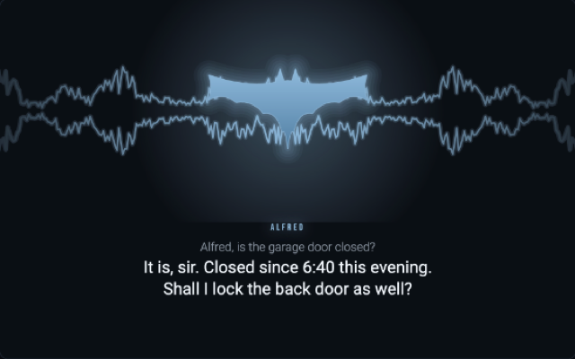

# Alfred (Bat Cave)

A plugin for [Kiosk Satellite](https://github.com/jxlarrea/kiosk-satellite) that changes what you see on the tablet while you talk to your voice assistant. Instead of the usual overlay, a glowing bat fills the screen: it lights up with the words, two lines spike out from its wings like an oscilloscope, and it spins when the assistant is done.

Kiosk Satellite calls this a voice skin. It changes only the look of a voice turn. Your assistant, wake word and voice stay as they are.

## What you need

- Kiosk Satellite 2026.10.39 or later.
- Voice Satellite set up and working in Kiosk Satellite: you can say the wake word and get an answer. The skin has nothing to draw without it.

## Installation

The button opens the plugin in your Kiosk Satellite, where you review it and choose **Trust and install**. To install it by hand instead:

1. Open **Settings > Plugin Manager** in Kiosk Satellite and turn on **Enable Plugins**.
2. Choose **Add plugin**, paste `https://github.com/hopkinsag1/kiosk-satellite-alfred-skin` and choose **Preview**.
3. Review the plugin and choose **Trust and install**.

Then turn it on. Installing alone changes nothing on screen:

1. In **Plugin Manager**, switch **Alfred (Bat Cave)** on. A newly installed plugin starts switched off.
2. Open **Settings > Voice Satellite > Appearance > Assistant 1 skin** and pick **Alfred (Bat Cave)**.
3. Press **Preview** to see it for five seconds, or say your wake word.

If you use two assistants, **Assistant 2 skin** in the same place sets the look for the second one. Pick a different skin for each to tell them apart.

## What you see

| When | What the skin shows |
| --- | --- |
| You speak | The two lines follow your voice out from the bat's wings, and the bat glows a little with it. |
| The assistant thinks | A heartbeat pulse travels outward once a second while the bat breathes. |
| The assistant answers | The bat's glow follows the spoken words and the lines spike with them. The label under the bat lights up. |
| The answer is finished | The bat spins, a nod to the scene changes of 1966 television, then settles with the answer still on screen. |
| The overlay closes | The bat spins away. |

What you said and the answer show under the bat, as they do with the built-in skins.

Kiosk Satellite has two overlay modes, and the skin draws both. Full screen covers the kiosk, as in the picture above. Docked shows a small card at the bottom of the screen with a small bat beside the conversation, and leaves the dashboard in view and usable.

## Settings

Open **Settings > Plugin Manager > Alfred (Bat Cave)**. Every setting is optional.

| Setting | What it does |
| --- | --- |
| Label under the bat | The word in small capitals under the bat, lit while the assistant answers. `ALFRED` by default. Leave it empty for no label. |
| Trace height | How far the two voice lines spike: Low, Normal or Tall. |
| Bat color | The bat, its glow and the rings of the spin. |
| Trace color | The two voice lines. |
| Text color | The answer, what you said and the label. |
| Bat spin | When the bat spins: **Command complete and close** (the default), **Close only** or **Off**. |

Left at their defaults, the three colors are blue with near-white text under the Dark theme, and a deeper blue with near-black text under the Light theme. A color you pick is used under both themes.

The skin also follows the settings under **Settings > Voice Satellite > Appearance**, the way the built-in skins do:

| Setting | What the skin does |
| --- | --- |
| Theme | Draws its light or dark look. |
| Background | Sets how solid the full screen backdrop is. **Skin default** is a near-solid black. |
| Text size | Scales the conversation and the label. |
| Reactive activity bar | While off, nothing moves with the voice. |

## If something looks wrong

- **The usual overlay shows instead of the bat.** Check that the plugin is switched on in **Plugin Manager** and picked under **Assistant 1 skin**. If the plugin stops, Kiosk Satellite falls back to its own skin until the plugin runs again.
- **The bat shows for one assistant but not the other.** Each assistant has its own skin setting. Pick **Alfred (Bat Cave)** under **Assistant 2 skin** too.
- **The bat and the lines stay still.** Turn on **Reactive activity bar** under **Voice Satellite > Appearance**.
- **The plugin will not install.** Kiosk Satellite names the version it needs. Update Kiosk Satellite to 2026.10.39 or later.

## Data

The plugin reads only the kiosk's own Voice Satellite state: whether its skin is picked, the voice level, the stage of the turn and the words shown on screen. It sends nothing anywhere, stores nothing and does not talk to Home Assistant.

## For developers

GitHub Actions builds a ZIP on every push (**Actions > Build**) and runs the headless tests. Publishing a release tagged with the version, such as `v0.3.0`, runs **Release**, which attaches the files Kiosk Satellite installs. Kiosk Satellite accepts only release files that GitHub Actions attached.

**Plugin Manager > Developer Tools > Install from ZIP** installs a build ZIP on a kiosk that does not have the plugin yet. Kiosk Satellite refuses a ZIP over a copy installed from this repository: uninstall that copy first.

To build locally you need Python 3, JDK 17 or newer and an Android SDK with `platforms;android-35` and `build-tools;35.0.0`. Then run `python3 tools/test.py` and `python3 tools/build.py --android-platform 35`.

The SDK under `sdk/` and the build tools under `tools/` come from [kiosk-satellite-plugins](https://github.com/jxlarrea/kiosk-satellite-plugins) (Apache-2.0). Changes are listed in [CHANGELOG.md](CHANGELOG.md).

## License

[Apache-2.0](LICENSE)
